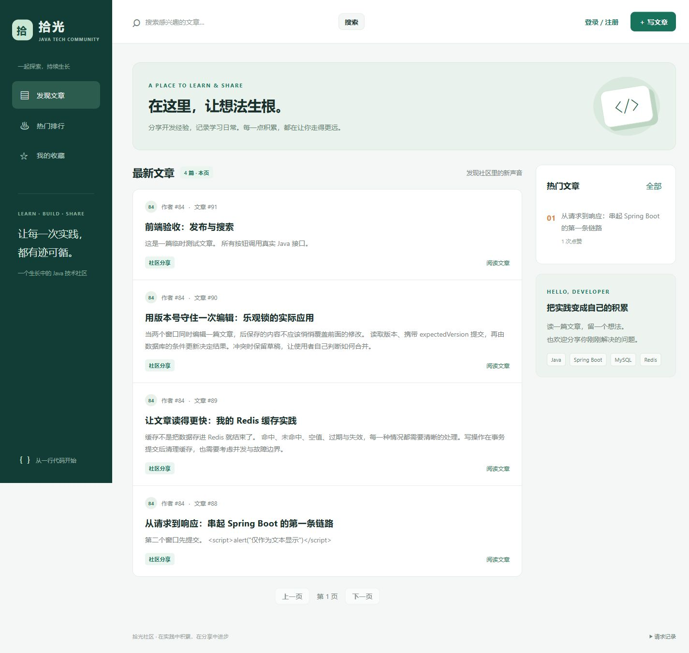

# Java Tech Community

一个基于 Spring Boot 的技术社区项目。提供后端 API 和“拾光社区”简易演示前端，支持用户认证、文章发布与编辑、评论、点赞、收藏、热门榜，以及文章历史版本的比较和恢复。前端使用原生 HTML、CSS 和 JavaScript，由同一个 Spring Boot 应用提供，无需安装 Node.js 或单独启动前端服务。

## 前端预览

下面是“拾光社区”首页的实际截图，使用临时演示数据。



截图用于快速了解界面外观。体验登录、发文和历史版本等完整功能，请按下方的[本地运行](#本地运行)步骤启动项目。

## 已实现功能

| 模块 | 功能 |
| --- | --- |
| 用户与认证 | 注册、BCrypt 密码哈希、表单登录和退出。Spring Security 处理认证与 CSRF 校验，Spring Session 将会话保存在 Redis |
| 文章与互动 | 文章列表、标题搜索、分页、详情、发布、编辑和删除。提供评论、点赞和收藏；文章编辑和删除检查作者身份 |
| 历史版本 | 修改前保存标题和正文快照，支持查看历史、逐行对比和恢复。编辑和恢复检查当前版本，拒绝过期请求并返回 `409` |
| 缓存与热门榜 | Redis 缓存文章详情，也对查不到的文章设置短时空值缓存。编辑和删除在事务提交后失效缓存；热门榜按点赞数定时写入 Redis ZSET |
| 评论限流 | Redis Lua 脚本按用户统计固定窗口内的评论请求，窗口为 60 秒，超过 5 次返回 `429` |
| 演示页面 | 响应式文章列表、搜索、热门榜、我的收藏和文章详情；登录注册、发文编辑、评论、点赞收藏及历史对比恢复。写操作自动携带 CSRF，编辑冲突保留输入 |

技术栈为 Java（编译目标 17）、Spring Boot 4.1.2、Spring MVC、Spring Security、Spring Session、MyBatis 及 Maven。MySQL 保存业务数据，Redis 用于会话、缓存、榜单和限流。

## 本地运行

准备 JDK 17 或更高版本、Maven、MySQL 和 Redis 兼容服务。本项目使用 JDK 21、MySQL 8.4 和 Memurai 在 Windows 上验证。以下命令从仓库根目录执行。

### 1. 初始化数据库

启动 MySQL。从仓库根目录执行 `mysql -u root -p`（按需替换管理员用户名），在新建的空库中执行以下命令。`SOURCE` 是 `mysql` 命令行客户端的命令。如果使用图形客户端，选中 `community_study` 后执行同一份 [建表脚本](sql/community-schema.sql)。

```sql
CREATE DATABASE IF NOT EXISTS community_study
    CHARACTER SET utf8mb4 COLLATE utf8mb4_0900_ai_ci;
USE community_study;
SOURCE sql/community-schema.sql;
```

为应用准备一个数据库账户。首次创建时将 `REPLACE_WITH_LOCAL_PASSWORD` 替换为自己的密码；已有应用账户时可以按需沿用。

```sql
CREATE USER 'community_app'@'localhost' IDENTIFIED BY 'REPLACE_WITH_LOCAL_PASSWORD';
GRANT SELECT, INSERT, UPDATE, DELETE ON community_study.* TO 'community_app'@'localhost';
```

### 2. 配置应用

启动 Redis 兼容服务。默认 MySQL 地址为 `127.0.0.1:3306`，Redis 地址为 `127.0.0.1:6379`。在仓库根目录创建 `config/application.properties`，填写应用账户的真实密码。该文件已被 `.gitignore` 忽略。

```properties
spring.datasource.password=REPLACE_WITH_LOCAL_PASSWORD
```

若服务地址或账号与默认值不同，可在同一外部文件中覆盖 `spring.datasource.url`、`spring.datasource.username`、`spring.data.redis.host` 和 `spring.data.redis.port`。部署时也可以使用 `SPRING_DATASOURCE_URL`、`SPRING_DATASOURCE_USERNAME`、`SPRING_DATASOURCE_PASSWORD`、`SPRING_DATA_REDIS_HOST` 和 `SPRING_DATA_REDIS_PORT` 环境变量。

### 3. 构建与启动

```powershell
mvn package
java -jar target/ssm-study-0.0.1-SNAPSHOT.jar
```

如果 Maven 由 IntelliJ IDEA 提供，可以从 Maven 工具窗口的 **Lifecycle** 执行 **package**。运行 JAR 时保持工作目录为仓库根目录，使 Spring Boot 能读到 `config/application.properties`。

启动后打开 **[http://localhost:8080/](http://localhost:8080/)** 即可使用演示界面。先注册并登录，发布一篇文章，再演示评论、点赞、收藏、编辑与历史恢复。编辑和历史操作仅在作者登录时显示；两个浏览器标签页同时编辑同一文章，可以演示 `409` 冲突和草稿保留。热门榜约每分钟更新。

页面正文为纯文本，支持换行。现有接口返回作者/评论用户 ID，因此页面按 ID 展示；收藏与取消收藏提供独立按钮，收藏结果可在“我的收藏”核对。页面不预置账号或模拟业务数据。底部“请求记录”可查看最近接口的状态和耗时，不保存密码、令牌或响应正文。

在 IDEA 中运行 `SsmStudyApplication` 也可使用页面；工作目录保持仓库根目录。不要直接双击 `index.html`，它需要同源的 Java 接口。若使用此前的 JAR，请重新打包，旧包不含前端文件。

也可访问以下公开接口。新建的空库返回 `[]` 是正常结果。

```powershell
curl.exe "http://localhost:8080/api/articles?page=1&pageSize=10"
curl.exe "http://localhost:8080/api/articles/hot?limit=10"
```

## 主要 API

| 功能 | 方法和路径 |
| --- | --- |
| 注册、获取 CSRF、查询当前用户 | `POST /api/auth/register`、`GET /api/auth/csrf`、`GET /api/auth/me` |
| 登录、退出 | `POST /login`、`POST /logout` |
| 列表、搜索、详情 | `GET /api/articles`（`keyword`、`page`、`pageSize`）、`GET /api/articles/{id}` |
| 发布、编辑、删除 | `POST /api/articles`、`PUT /api/articles/{id}`、`DELETE /api/articles/{id}` |
| 查看和发表评论 | `GET /api/articles/{id}/comments`、`POST /api/articles/{id}/comments` |
| 点赞、取消点赞 | `PUT /api/articles/{id}/like`、`DELETE /api/articles/{id}/like` |
| 收藏、取消收藏、我的收藏 | `PUT /api/articles/{id}/favorite`、`DELETE /api/articles/{id}/favorite`、`GET /api/me/favorites` |
| 热门文章 | `GET /api/articles/hot?limit=10` |
| 历史列表、快照详情 | `GET /api/articles/{id}/versions`、`GET /api/articles/{id}/versions/{versionId}` |
| 对比历史快照 | `GET /api/articles/{id}/versions/diff?fromVersionId=1&toVersionId=2` |
| 恢复快照 | `POST /api/articles/{id}/versions/{versionId}/restore` |

调用需要写入的接口时，先从 `GET /api/auth/csrf` 取回 `headerName` 和 `token`，在同一客户端保留 `SESSION` Cookie，并按返回的名称发送 CSRF 请求头。注册使用 JSON 字段 `username` 和 `password`，登录使用同名的表单字段。登录后重新取令牌，再调用需要身份的接口。

编辑文章时，先读取详情中的 `version`，把该值作为 `expectedVersion` 提交。恢复接口请求体只需 `expectedVersion`。`versionId` 指向历史快照，当前文章的 `version` 用于检查并发更新。

```json
{
  "title": "更新后的标题",
  "content": "更新后的正文",
  "expectedVersion": 0
}
```

## 项目结构

```text
src/main/java/com/example/ssmstudy/  后端应用
  controller/                       HTTP 接口
  service/                          业务逻辑、事务与 Redis 操作
  mapper/                           MyBatis SQL 与数据映射
  model/、dto/                       数据模型与请求/响应对象
src/main/resources/                 默认配置与限流 Lua 脚本
  static/                           演示首页、样式与交互脚本
sql/community-schema.sql            六张业务表的初始化结构
src/test/                          Spring Boot 上下文测试
```

## 验证与后续计划

已在 Windows 上通过 Maven 打包和上下文测试，并用可执行 JAR 验证了文章查询、热门榜及 Redis 会话。另验证了应用进程重启后的会话保留、文章读写及详情缓存回填。

后续计划包括有界线程池批量预热、MySQL 查询优化、热点缓存重建协调，以及 RabbitMQ 评论通知的可靠处理。
